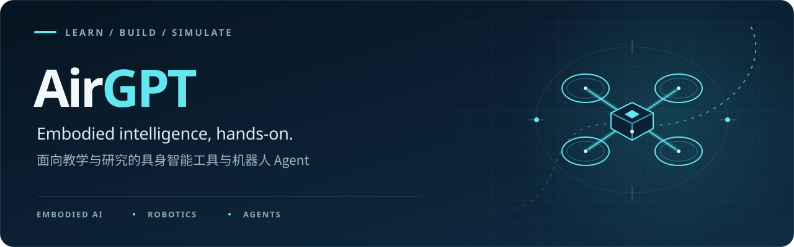

Hands-on learning and tools for **embodied intelligence, robotics, and agents**.

面向教学与研究的具身智能工具与机器人 Agent

## Learn

- **[io_airgpt](https://github.com/airgpt6/io_airgpt)** · A practical LLM + drone course covering AirSim, agents, multi-drone coordination, VLA, and world models. A real-drone deployment guide is planned.
- **[learn_io_ai](https://github.com/airgpt6/learn_io_ai)** · A bilingual Chinese–English course for learning AI with io.net.

## Build

- **[gym-agent](https://github.com/airgpt6/gym-agent)** · A language-native, MCP-ready agent runtime built around persistent sessions and human-in-the-loop workflows.
- **[airgpt-rt](https://github.com/airgpt6/airgpt-rt)** · A FastAPI and CLI model-service layer. In development, with no published releases.

## Simulate

- **[airsim_agent](https://github.com/airgpt6/airsim_agent)** · A Chinese-language AirSim + LLM course for exploring agents in simulated environments.

---

These five repositories are forks of projects from [maris205](https://github.com/maris205). Check each repository and its upstream source for current scope, setup instructions, and development status.
